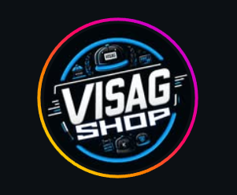
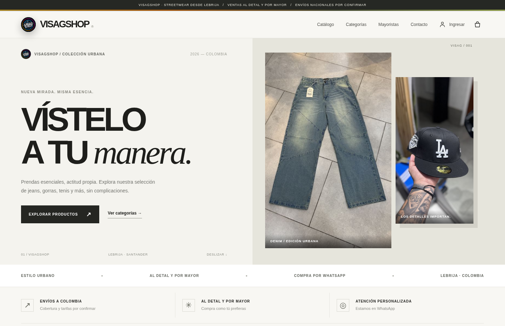
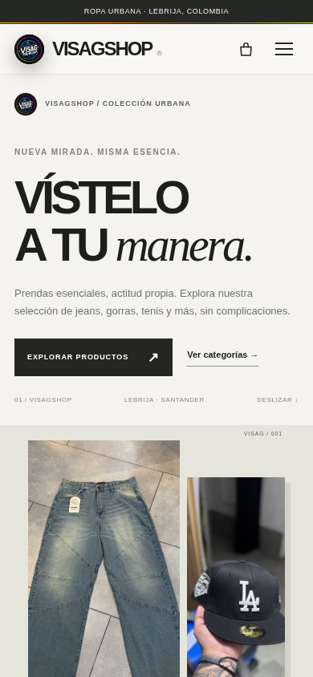
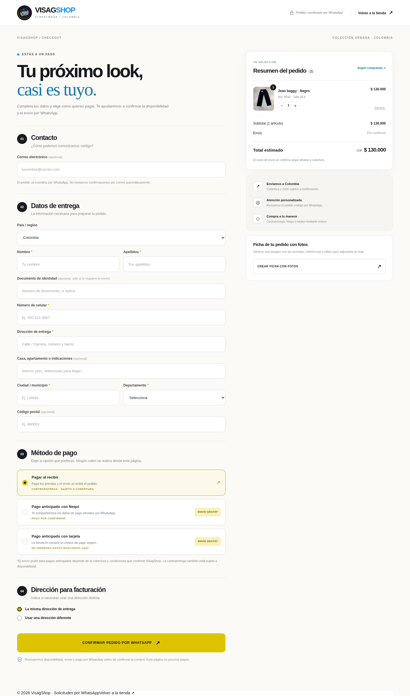
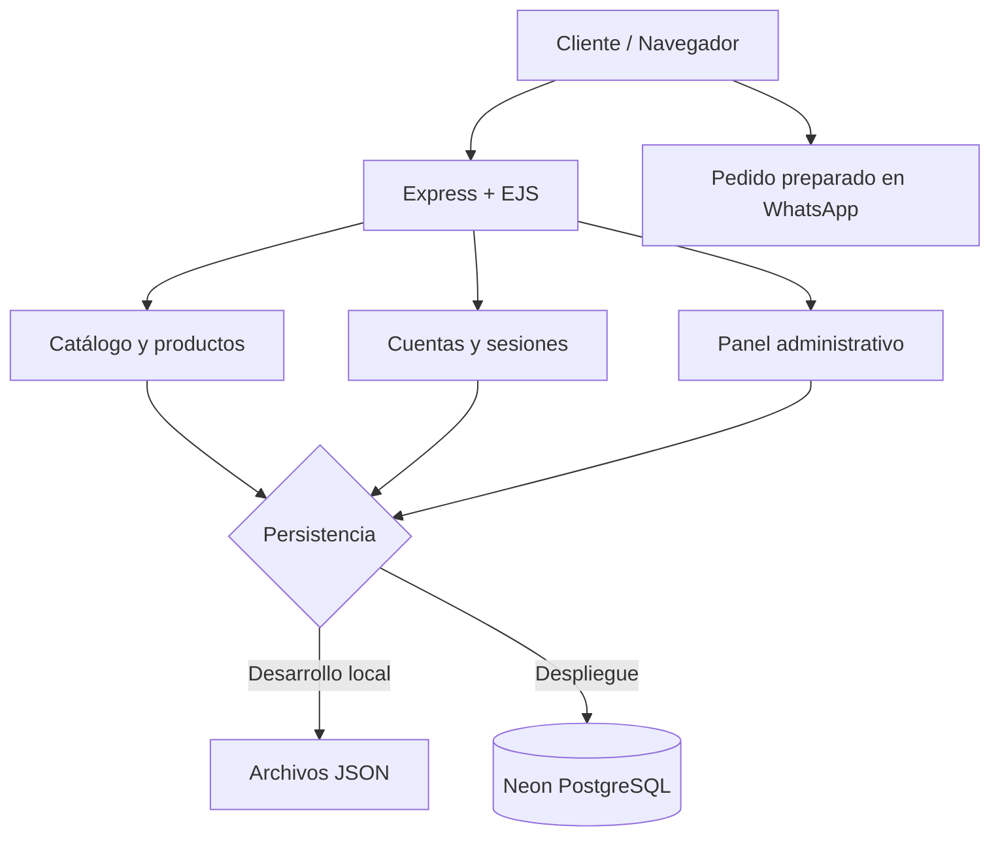

<div align="center">
  

  # VISAGSHOP

  **Tienda virtual de moda urbana · Aplicación web full stack**

  [**🌐 Explorar la tienda**](https://visagshop.onrender.com) · [**📖 Arquitectura**](docs/ARQUITECTURA.md) · [**🧪 Pruebas**](docs/PRUEBAS_Y_LIMITACIONES.md)

  
  
  
  
  
</div>

---

## Descripción

**VisagShop** es una aplicación web para explorar y gestionar un catálogo de moda urbana. Integra una interfaz adaptable a móviles, herramientas para encontrar prendas, un carrito de compra y un **flujo de solicitud de pedidos por WhatsApp**. En el servidor dispone de cuentas de clientes, sesiones y administración del catálogo.

El proyecto se desarrolló como práctica de arquitectura web con **Node.js, Express, plantillas EJS y persistencia de datos**. Se puede ejecutar con JSON en desarrollo local o con **PostgreSQL (Neon)** cuando se configura `DATABASE_URL` para su publicación en Render.

> **Alcance real:** la plataforma permite **solicitar** y preparar pedidos, no efectuar cobros automáticos. Disponibilidad, costos de envío y pagos anticipados se confirman con la tienda. La página de recuperación de contraseña por correo aún no está implementada.

## Vista previa

<div align="center">
  <a href="https://visagshop.onrender.com"></a>
  <p><em>Portada de VisagShop, basada en las plantillas del código de este repositorio.</em></p>
</div>

| Inicio en móvil | Checkout de pedido |
| :---: | :---: |
|  |  |

> Capturas tomadas de una **representación local del código EJS del repositorio** con datos de demostración (no contienen datos de clientes). Para comprobar el servicio desplegado, visita la [demo en línea](https://visagshop.onrender.com).

## Funcionalidades

| Área | Funciones incluidas |
| --- | --- |
| **Catálogo** | Productos por categoría, búsqueda, orden por nombre/precio y favoritos locales. |
| **Fichas** | Fotografías, referencias, tallas y precio, cuando está definido. |
| **Carrito** | Cantidades, selección de talla, subtotal y ficha descargable con fotos. |
| **Pedidos** | Formulario de entrega y preparación de mensaje para WhatsApp. |
| **Pago solicitado** | Contraentrega, Nequi o tarjeta por enlace enviado por la tienda; **sin cobro integrado**. |
| **Clientes** | Registro, acceso, cierre de sesión, “recordarme”, perfil y cambio de contraseña. |
| **Administración** | Alta, consulta, edición y eliminación de productos con validación de imágenes. |
| **Persistencia** | JSON local para desarrollo; PostgreSQL en la configuración de alojamiento gratuito. |

El catálogo inicial incluye **108 referencias y 108 fotografías**. Algunas referencias aún requieren completar información comercial (por ejemplo, precio o tallas), por lo que se presentan como **por consultar** cuando corresponde.

## Tecnologías

- **Frontend:** HTML5, CSS3, JavaScript y plantillas EJS.
- **Backend:** Node.js, Express 4, controladores y rutas HTTP.
- **Datos:** archivos JSON locales; PostgreSQL con el paquete `pg` en la versión desplegada.
- **Autenticación:** contraseñas derivadas con `scrypt` y sesiones revocables almacenadas en el servidor.
- **Despliegue:** GitHub como repositorio, Render como servidor y Neon para PostgreSQL.
- **Calidad:** pruebas automatizadas con `node:test`.

## Arquitectura



Consulta [**la documentación de arquitectura**](docs/ARQUITECTURA.md) para entender las carpetas y el almacenamiento de imágenes.

## Instalación local

Necesitas **Node.js 20 o superior** y npm.

```bash
# Abre una terminal dentro de la carpeta que contiene package.json
npm install
npm start
```

Visita **http://localhost:3000**. En desarrollo local, sin `DATABASE_URL`, la aplicación usa archivos JSON.

Otros comandos disponibles:

```bash
npm run dev  # Recarga de Node al cambiar archivos
npm test     # Pruebas automatizadas
npm run check # Validación sintáctica del servidor
```

> **No ejecutes `npm install` desde una carpeta superior sin `package.json`.** En Windows, usa Visual Studio Code → **Archivo → Abrir carpeta** y selecciona la carpeta del proyecto.

### Variables para publicar en la nube

| Variable | Función |
| --- | --- |
| `NODE_ENV` | `production` al publicar. |
| `DATABASE_URL` | Cadena privada de conexión PostgreSQL de Neon. |
| `ADMIN_USERNAME` | Usuario privado para el panel. |
| `ADMIN_PASSWORD` | Contraseña larga y única para el panel. |
| `WHATSAPP_NUMBER` | Número oficial para abrir el chat con el pedido preparado (opcional). |
| `PORT` | Puerto del servidor; Render lo establece automáticamente. |

Toma como referencia [`.env.example`](.env.example), **sin escribir credenciales reales en archivos que se suban a GitHub**. El servidor exige `DATABASE_URL` cuando `NODE_ENV=production`.

La URL de comprobación del servicio es `/health`.

## Rutas destacadas

| Ruta | Descripción |
| --- | --- |
| `/` | Inicio y catálogo. |
| `/products` | Listado de productos. |
| `/products/:id` | Detalle de producto. |
| `/productCart` | Carrito y solicitud de compra. |
| `/register`, `/login` | Registro y acceso. |
| `/profile` | Área privada de cliente. |
| `/admin/products` | Administración de productos con credenciales. |
| `/api/products` | Consulta JSON del catálogo. |
| `/health` | Comprobación básica del servicio. |

## Pruebas y consideraciones

Ejecuta `npm test` desde la raíz. Las pruebas cubren modelos de productos, registro, autenticación, sesiones, rutas, controles de acceso y adaptadores de persistencia. **Las pruebas con adaptadores simulados no equivalen a una auditoría de seguridad ni a pruebas en infraestructura real**.

Para conocer las restricciones actuales y las verificaciones recomendadas antes de mostrar la tienda a un reclutador o usarla con clientes, consulta [**Pruebas y limitaciones**](docs/PRUEBAS_Y_LIMITACIONES.md).

## Posibles mejoras futuras

- Pasarela de pagos real gestionada por un proveedor especializado.
- Gestión de pedidos con historial, estados y seguimiento.
- Recuperación de contraseña con verificación por correo.
- Completar precios, tallas y demás datos de todo el catálogo.
- Mejoras de pruebas end-to-end, rendimiento, accesibilidad y respaldo de datos.

## Presentación del proyecto

Esta aplicación muestra experiencia práctica con **desarrollo full stack, separación de responsabilidades, CRUD, persistencia, autenticación y despliegue**. Se presenta como **proyecto demostrativo y evolutivo**, sin atribuirle características aún no implementadas.

**Demo:** https://visagshop.onrender.com

> **Licencia:** este repositorio no incluye una licencia de reutilización. Los nombres, logotipos y fotografías pertenecen a sus respectivos titulares; su inclusión en el portafolio no autoriza reutilizarlos sin permiso.
